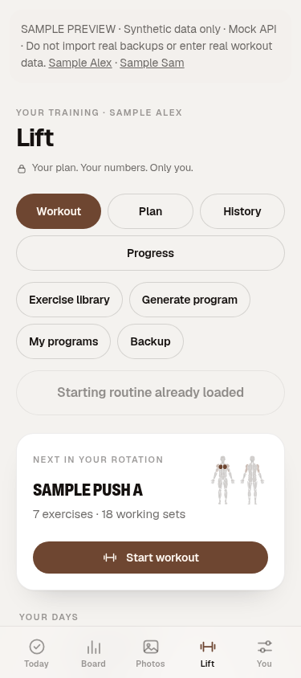
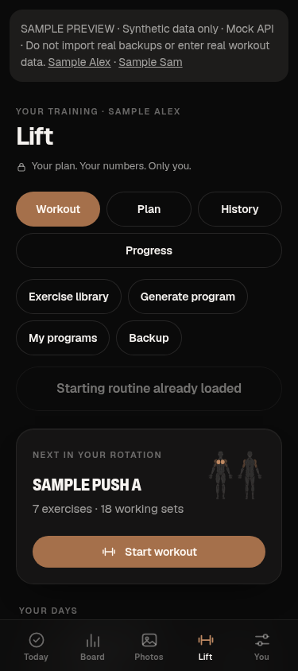
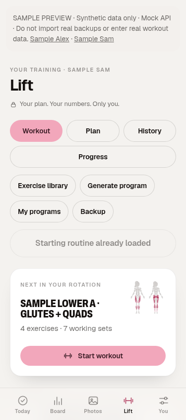
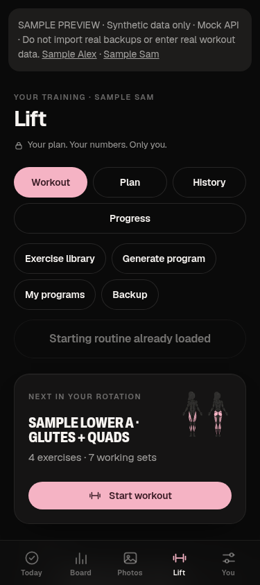
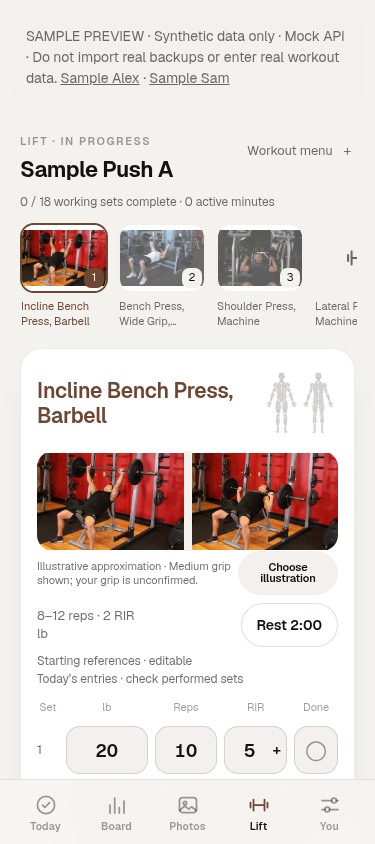
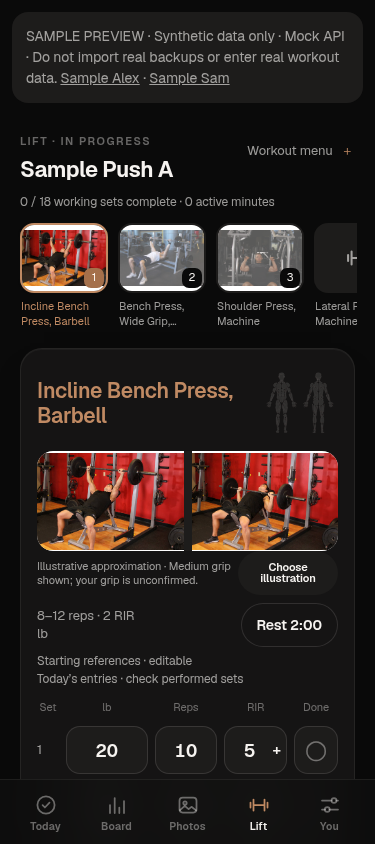
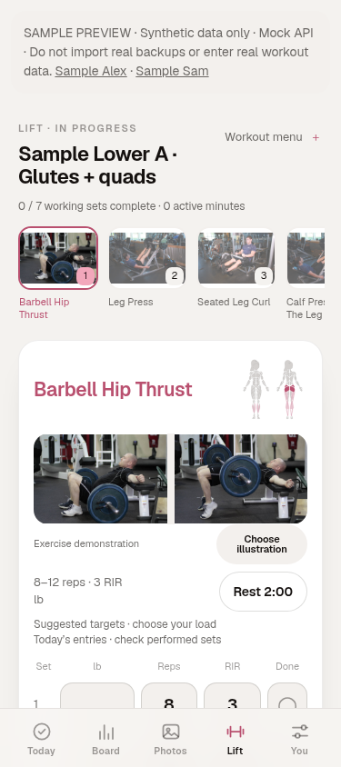
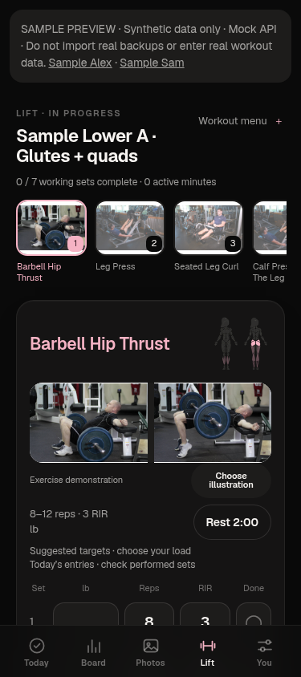

# Lift visual polish review

Screenshots use isolated mock APIs, synthetic profiles (Sample Alex/Carlos and Sample Sam/Sue), and invented starting numbers. No private links, production profiles or real logged workouts are shown. Overview screenshots are actual Chromium at 375 × 844px, captured from the exact staged application snapshot. The small front/back target icon opens a larger diagram and context when tapped. Female/male artwork is selected from Sue/Carlos's profile automatically; there is no selector. Primary muscles use the profile accent; secondary groups use hatching.

| Profile | Light | Dark |
| --- | --- | --- |
| Carlos |  |  |
| Sue |  |  |

Active workout screenshots from the same synthetic snapshot:

| Profile | Light | Dark |
| --- | --- | --- |
| Carlos |  |  |
| Sue |  |  |

Licenses: exercise photos use the pinned Free Exercise DB Unlicense with provenance in `icons/exercises/SOURCE.md`; body paths retain the MIT license and copyright in `icons/muscles/`.

The previously reported **19 local suites** applied to the combined working tree, including the separate optional Photos bodyweight feature. This visual-polish commit deliberately excludes that feature and its suite. **18 local suites** were rerun on an exact staged export: 17 `.test.mjs` suites and `note-slots.test.ts`. Browser evidence for the same application snapshot: six workout scenarios, 12 visual scenarios, six muscle-map scenarios. All use 320/375/390px and both themes; visual and muscle tests cover both profiles. Checks include entered values/notes/qualifiers/reload, timer continuity/pause, offline Finish/retry, illustration selection/failures, profile-specific compact muscle icons with tap-to-expand context, decoded local photos and no horizontal overflow.

Outstanding: physical iPhone keyboard/safe-area and camera interactions; background/locked-screen timer audio/vibration; installed-PWA service-worker updates, media caching, offline launch/reload and recovery. Desktop mobile emulation does not establish these results. Backend/Deno/PostgreSQL checks were not rerun for this presentation change; no Supabase code or schema changed.

Deployment inspection: GitHub Pages uses legacy publishing from `main /`, the Pages environment allows only `main`, the only workflow is GitHub's dynamic Pages workflow, and repository webhooks are empty. Pushing this feature branch does not deploy production under that configuration. This change must still receive review before a future authorized merge.
