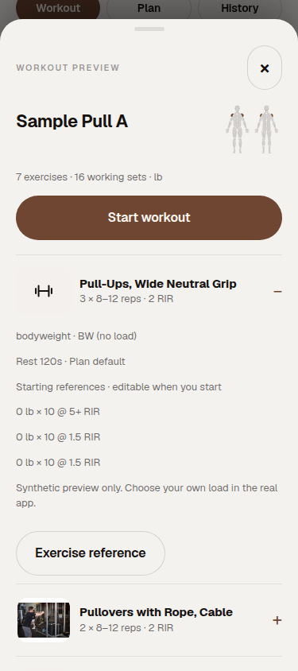
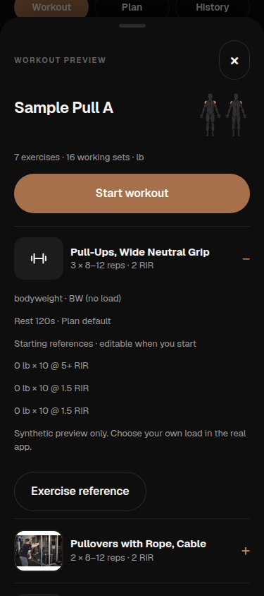
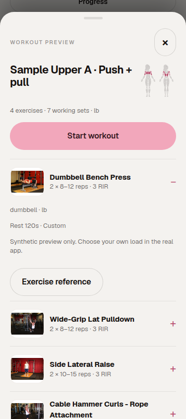
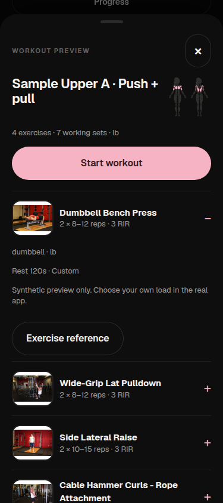
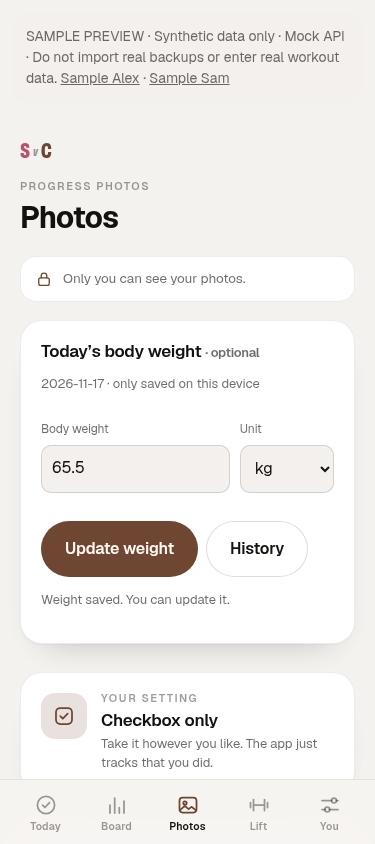
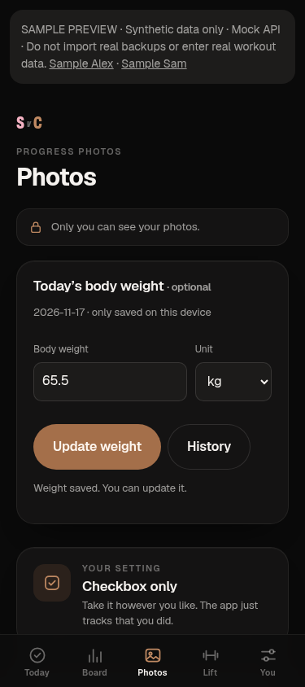
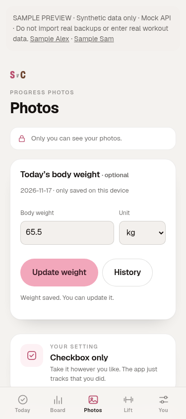
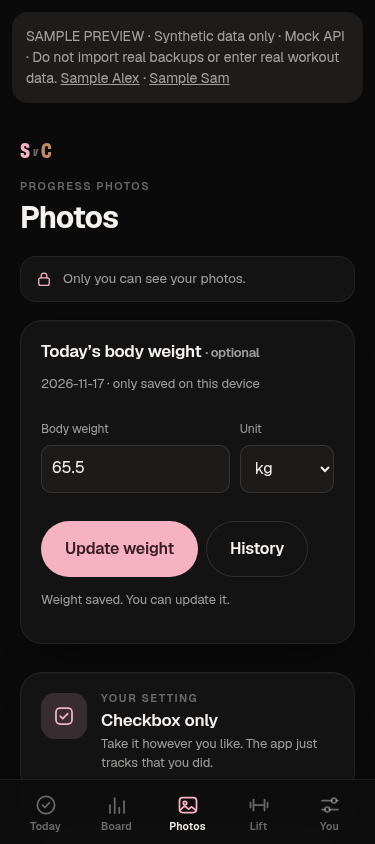

# Workout preview and optional body-weight review

Actual isolated Chromium screenshots at 375px. Sample Alex/Sam are synthetic profiles; all body weights and workout values shown are invented. No private production links or data.

| Flow | Carlos light | Carlos dark | Sue light | Sue dark |
| --- | --- | --- | --- | --- |
| Workout preview |  |  |  |  |
| Opt-in body weight |  |  |  |  |

19 local suites passed. Actual mobile-emulated Chromium: 12 preview scenarios (both profiles × three widths × both themes), 12 body-weight scenarios, six existing workout/timer/offline-save scenarios. Body weight is off by default, manually enabled per private profile/device in You, optional in Photos, device-local and excluded from Lift backups; CSV is available. Browsing workouts creates no draft or timer. Only explicit Start begins logging.

Physical iPhone camera/keyboard/safe-area, background audio/vibration and installed-PWA update/offline checks remain outstanding. No backend or Supabase changes. Free-image gaps and audit: ../../exercise-image-gaps.md.
